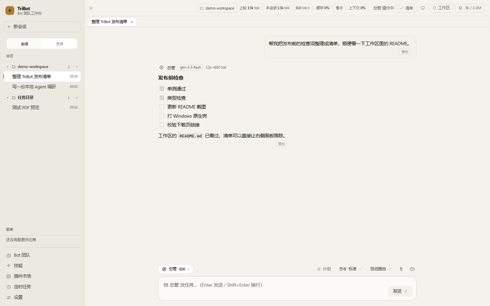
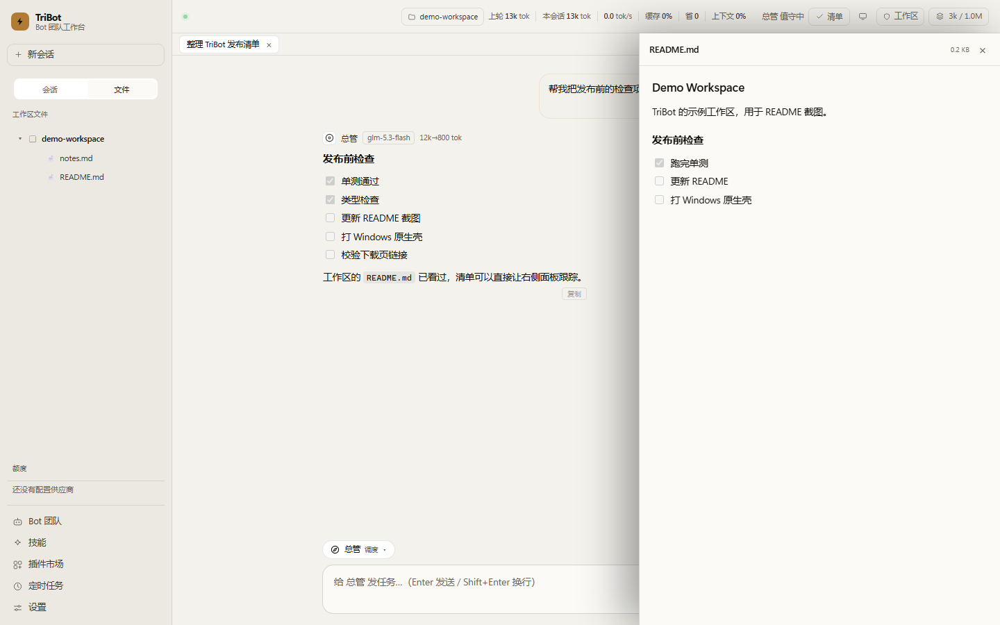

# TriBot · 本地 Bot 团队工作台

把任务丢给一支跑在自己电脑上的 Bot 团队：总管拆解、研究员查证、工程师动手、管家巡检、审稿人挑刺。模型、工具、文件、审批都在本机，数据不出门。



## 它是什么

TriBot 不是“又一个聊天框”，而是一个可审计的本地 Agent 工作台：

- **五个角色**：总管 / 研究员 / 工程师 / 管家 / 审稿人，各有系统提示词、输出契约和默认思考档位
- **工作区**：一个会话绑定一个目录，可追加多个目录；左侧按工作区分组，像文件夹一样展开/收起
- **文件侧栏**：直接在左侧「文件」tab 浏览工作区，Markdown / 代码 / 图片 / PDF 在右侧预览
- **会话标签页**：像文件一样打开、切换、关闭；关闭标签不删除会话
- **写前检查点**：Bot 覆盖/新建文件前自动快照，右侧「状态」面板可逐文件回滚
- **审批与沙箱**：只读 / 工作区 / 全权三档；高危命令、外网、MCP 调用逐次审批
- **真实工具**：读写文件、执行命令、浏览器、桌面自动化、MCP、SKILL.md 技能、定时任务
- **用量透明**：上轮/本会话 token、缓存命中率；设置里有按模型的饼图
- **多供应商**：GLM、MiniMax、DeepSeek 内置；任意 OpenAI 兼容供应商可自己加



## 快速开始

要求：**Node.js >= 22.5**、**pnpm >= 10**（仓库使用 pnpm 12.6）。

```bash
pnpm install
pnpm dev
```

首次启动：

1. 三步引导（介绍 → 配置模型 → 选任务文件夹）
2. 到 **设置 → 模型与凭证** 填 API Key（推荐；Key 只存在本机）
3. 新建会话，直接把任务丢给总管

只启动本地 server：

```bash
pnpm dev:server
# 浏览器打开 http://127.0.0.1:47615/
```

> 仓库**不包含任何 API Key**。`data/`、`.env`、`credentials.json` 等均被 `.gitignore` 排除。

## 常用命令

| 命令 | 作用 |
|---|---|
| `pnpm dev` | 桌面 App（Electron + 本地 server） |
| `pnpm dev:server` | 只启动本地 server，浏览器访问 |
| `pnpm dev:web` | 只启动 Vite 渲染层 |
| `pnpm test` | 全部单测 |
| `pnpm typecheck` | 全仓类型检查 |
| `pnpm cli -- chat` | 命令行聊天（`tb`） |
| `pnpm package` | Windows Electron 便携版 → `release/` |
| `pnpm package:native` | Windows 原生壳（C# + WebView2）→ `release/TriBotNative` |
| `pnpm package:targets` | 生成下载站产物（Windows / macOS / Linux） |

## 架构

```
packages/
├── core/     引擎：模型网关、路由、配额、工具执行、审批门、沙箱、
│             上下文压缩、SKILL.md、MCP、Routine
├── server/   Fastify REST + SSE，只监听 127.0.0.1
├── app/      Electron 主进程 + React 工作台 + 原生壳资源
├── cli/      tb 命令行（零依赖 HTTP 客户端）
└── shared/   三端共享类型与协议
shell/        Windows C# + WebView2 原生壳 / macOS·Linux Python + 系统 WebView
site/         静态下载页
scripts/      打包、基准、评测
docs/         安全、角色、设计、原生壳说明
```

数据流：

```
UI → 本地 server(127.0.0.1) → 引擎（路由 / 工具循环 / 审批）
   → SQLite(data/tribot.db) + 工作区文件 + 凭证密文
```

## 会话与工作区

- 会话按工作区分组；文件夹头 `+` 直接在该工作区新建会话
- 会话标题在首轮后由模型总结生成，不再截取第一句话；双击或右键可重命名
- 自定义标题写入 `meta.titleSource = custom`，之后不会被自动覆盖
- 会话标签页持久化；关闭标签只关视图，不删会话

## 安全

- API Key 使用 **AES-256-GCM** 加密存 `data/credentials.json`
- 桌面版主密钥由系统 DPAPI / Keychain（Electron safeStorage）保护；纯 Node 模式用本机 `.localkey` 兜底
- 界面只回显 `…尾号`，不返回完整 Key
- 服务只绑定 `127.0.0.1`
- 文件读写锁在会话工作区内；路径越界直接拒绝
- 高危动作逐次审批，授权可限定「本会话 / 总是」，设置里可撤销
- 发布包不包含 `data/`、`.env`、`credentials.json`

完整说明：[docs/security.md](docs/security.md)

## 原生壳（不用 Electron）

| 平台 | 实现 | 状态 |
|---|---|---|
| Windows | C# WinForms + WebView2，原生标题栏 | 已构建 |
| macOS | Python + WKWebView | 源码包 |
| Linux | Python + WebKitGTK | 源码包 |

```bash
pnpm package:native
# release/TriBotNative/TriBotShell.exe
```

macOS / Linux 需要各自平台编译与签名，仓库提供 `shell/tribot_shell.py` 与安装说明。详见 [docs/native-shell.md](docs/native-shell.md)。

## 测试与质量

```bash
pnpm test        # 165+ 单测：路由/沙箱/审批/凭证/压缩/工具/检查点
pnpm typecheck
```

关键设计：

- 所有 Bot 默认拥有全部工具（`["*","assign"]`），风险由沙箱与审批兜底
- 写文件前先 `read_file`，避免盲写覆盖
- 工具输出过长自动落盘，模型可用 `expand_output` 读回
- 同一工具重复调用会提醒换思路
- 输出截断自动续写，不会直接失败

## 在 ZCode / DSH 里使用 TriBot 的 Bot

TriBot 的五个角色合并成了一个技能，源文件在 [`zcode-skills/tribot/SKILL.md`](zcode-skills/tribot/SKILL.md)。ZCode 和 DSH 共用同一份内容（同时写了 `when_to_use` 与 `whenToUse`）。

**ZCode**

```bash
cp -R zcode-skills/tribot ~/.zcode/skills/
```

**DSH（DeepSeek Harness）**

```bash
cp -R zcode-skills/tribot ~/.dsh/skills/
```

加载 `tribot` 后会先让你选角色：

```
1. 🧭 总管   2. 🔍 研究员   3. 🛠 工程师
4. ⏰ 管家   5. 🧪 审稿人   6. 👥 团队
```

回复编号或名字即可；也可以直接说「用工程师」。技能只是指令，不含可执行代码或 API Key。
详见 [zcode-skills/README.md](zcode-skills/README.md) 和 [dsh-skills/README.md](dsh-skills/README.md)。

## License

MIT © 2026 Zhanjian Li。见 [LICENSE](LICENSE)。
